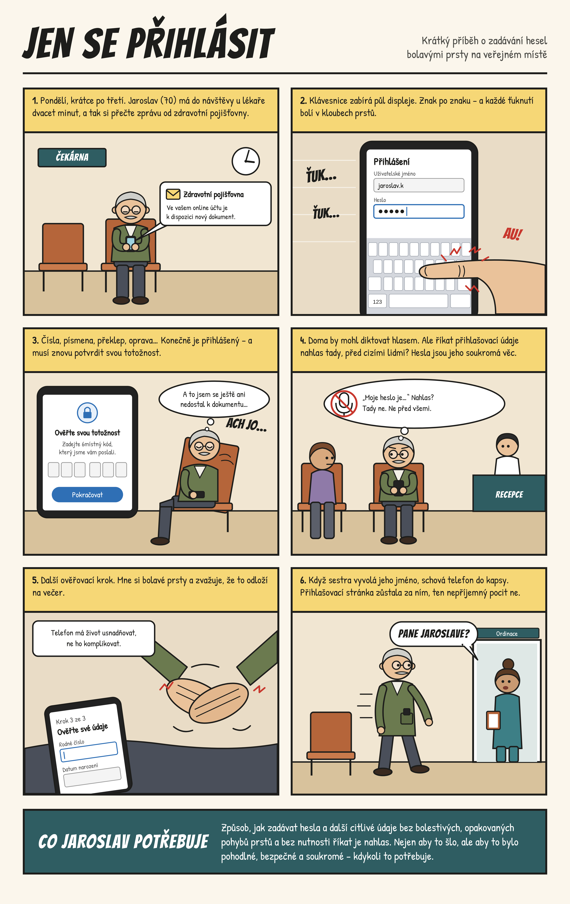

# Problem

Define alternative input method for people with hand mobility problems such as eczema or arthritis

## Key problems to solve

1. Hand mobility of fingers but not the entire hand
  - Includes: Eczema, Arthritis
  - Does not include: Parkinson's
2. Higher probability of worse eyesight
3. Unable to use voice dictation, password manage, biometric authentication due to a specific environmental setting

## User research

### Sources

The analysis uses third-party sources and the scenario we built from them ([scenario.md](scenario.md)):

- **W3C - Web Content Accessibility Guidelines (WCAG) 2.2**
- **Apple Human Interface Guidelines** and **Google Material Design**: recommended minimum touch-target sizes (44 × 44 pt and 48 × 48 dp)
- **WHO - Osteoarthritis fact sheet**: how common arthritis is and how it relates to age
- Epidemiological literature on **hand eczema** (e.g. Quaade et al., 2021, a systematic review of hand eczema prevalence)
- General knowledge of age-related vision changes (*presbyopia*) and of password-entry security (*shoulder surfing*)

### Target user group

- Mainly older adults (60+) with **arthritis of the finger joints**, and people of any age with **hand eczema**
- They can still move the hand and wrist as a whole. Fine finger movements (precise tapping, repeated presses, pinching) are what hurts or is slow
- They often see worse up close as well
- They value being **independent** (not asking family for help)

### Summary of knowledge gained

1. **The problem is common and grows with age.**
2. **Repeated, precise finger movements are the main barrier.** Typing as well as correcting mistakes hurts or slows down the input process significantly
3. **Errors cost more for these users.**
4. **Authentication flows are getting longer.** Verification codes, multistep identity checks, and personal-data forms (see the scenario)
5. **The usual workarounds don't help in every situation:**
   - *Voice dictation* is a privacy problem in public
   - *Biometrics* can become unreliable or not available with certain devices
   - *Password managers/autofill* don't help with data that is entered for the first time or changes each time
6. **Users want to stay independent and keep their privacy.** A solution that is noticeable or embarrassing to use won't get used.

### User requirements

| ID  | Requirement                                                                                                                      | Rationale                                                                            |
|-----|----------------------------------------------------------------------------------------------------------------------------------|--------------------------------------------------------------------------------------|
| R1  | Entering a password or code must take **far fewer precise finger taps** than a standard on-screen keyboard                       | Main source of pain (findings 2, 4)                                                  |
| R2  | Input must be possible with **coarse movements** of the hand/wrist or large touch areas (well above 44 × 44 pt, limitted amount) | Fingers have limited mobility, the whole hand doesn't (finding 2, WCAG 2.5.7, 2.5.8) |
| R3  | Input must be **silent and discreet**                                                                                            | Privacy in public places (finding 5)                                                 |
| R4  | The method must **not depend on fingerprints** or other biometrics                                                               | Eczema / bandages make biometrics unreliable (finding 5)                             |
| R5  | **Large, high-contrast** visual feedback that respects the system font size, and clear confirmation of each input step.          | Worse near vision (finding 1)                                                        |
| R6  | **Error tolerance**: easy undo of the last character                                                                             | Higher error rate (finding 3)                                                        |
| R7  | Works **anywhere a normal keyboard works** with no support from the website or app.                                              | Real flows mix many kinds of input (finding 4)                                       |
| R8  | **Easy to learn** and familiar, usable after a short introduction without help from others                                       | Independence, older users (finding 7)                                                |
| R9  | Security must be **at least as good** as typing on a standard keyboard                                                           | Users are entering sensitive data (findings 4, 5)                                    |
| R10 | Comfortable to use **while seated and holding the phone** in typical public settings                                             | Usage context from the scenario                                                      |

## Scenarios

- Just log in: [scenario.md](scenario.md)
- Story board: [story_board.png](resources/story_board.png)

## Model of a future solution

- HTA for a special scenario: [hta.md](hta.md)
- Scratches of potential future solutions: [models.jpg](resources/models.jpg)
  